# PULSERA

### Train Smarter. Adapt Stronger.

A premium fitness and wellness app for Android and iOS, built with React Native and
TypeScript. Eight training plans, a 43-exercise library, nutrition and water tracking,
body-composition history, a weekly planner that reschedules itself around you, and a
coach you can ask questions.

**It runs entirely offline.** Every plan, food, chart, challenge and reply is served from
data bundled with the app — no backend, no API keys, no connection required after install.

  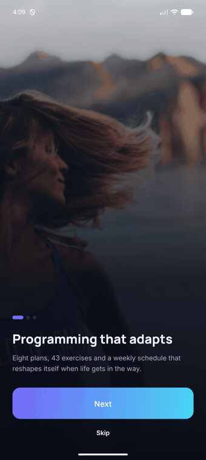

---

## Screens

  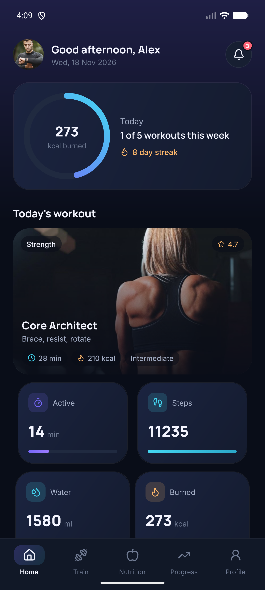
  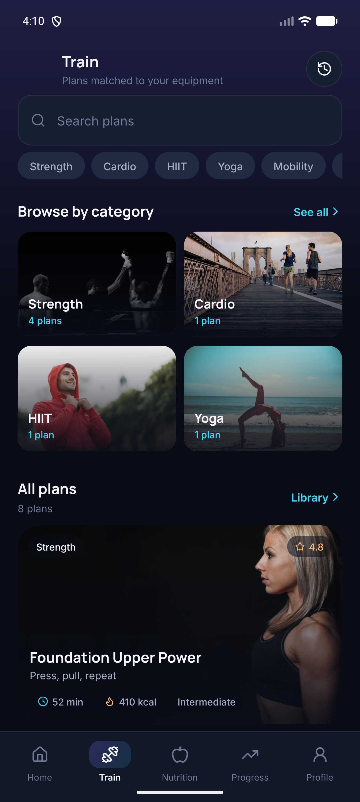
  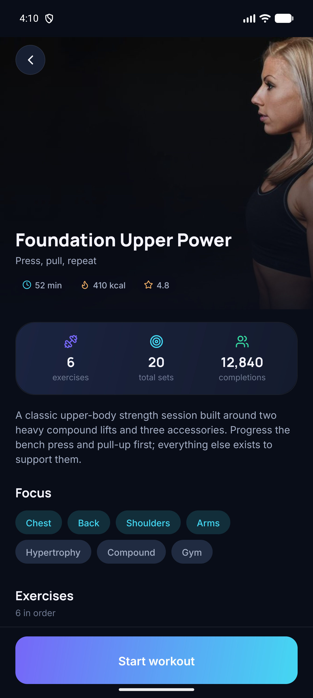
  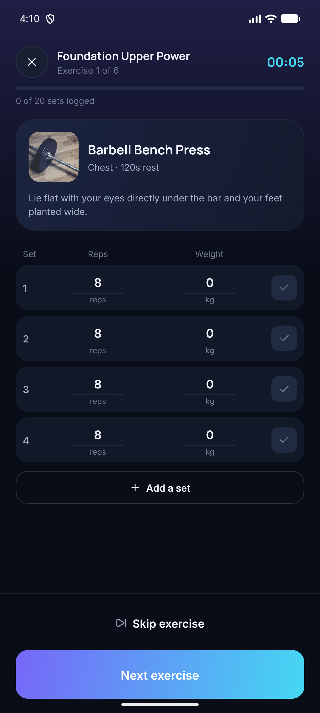

  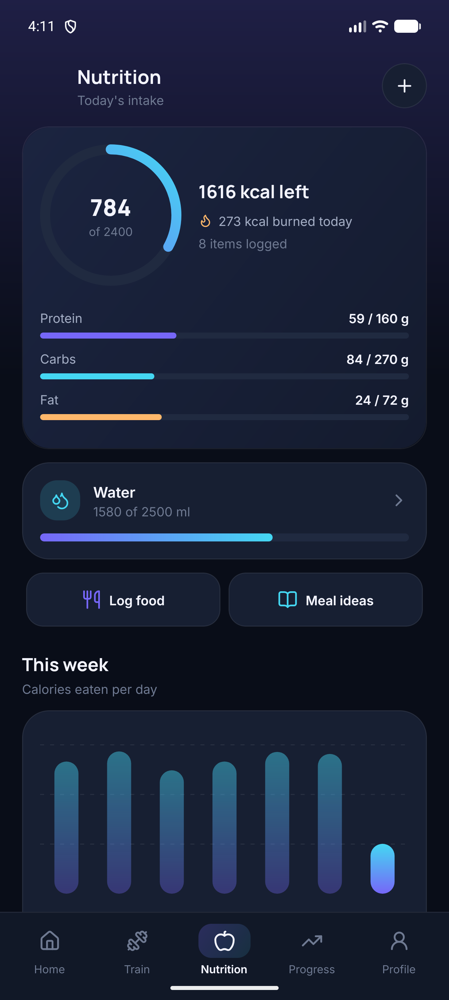
  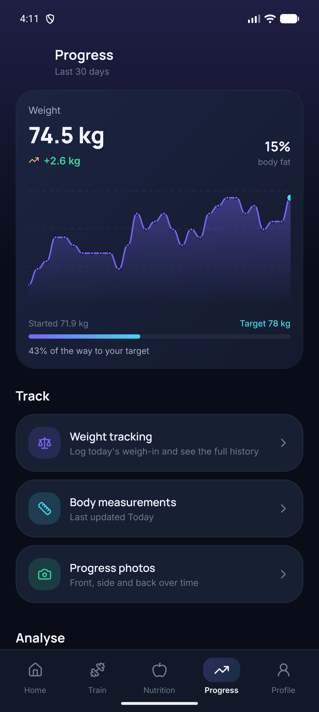
  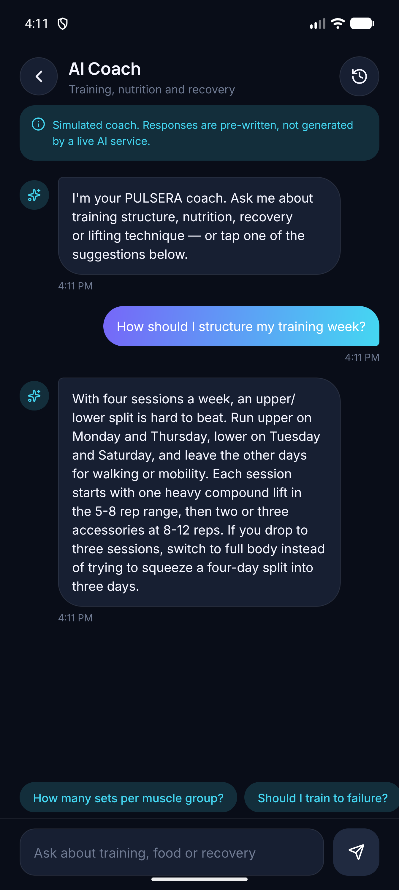
  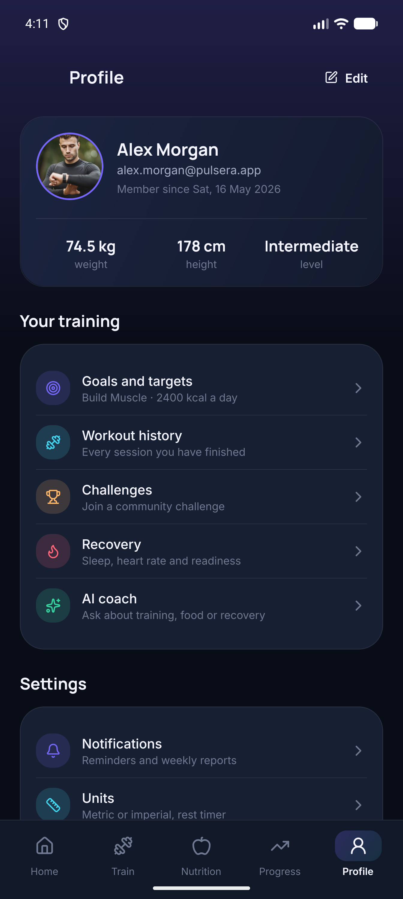

More — onboarding, rest timer, profile

  
  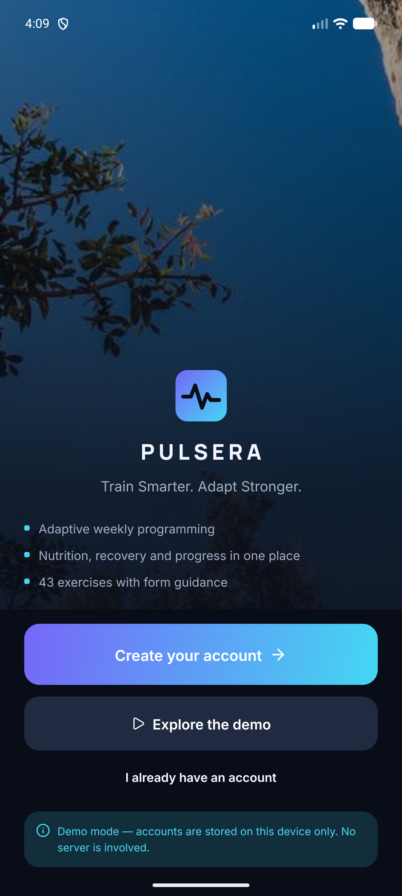
  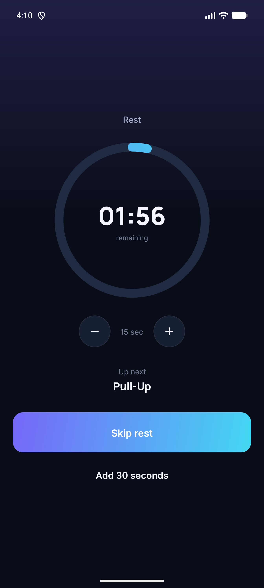

---

## What it does

**Training** — 8 plans across 6 categories, a 43-exercise library with instructions, form
cues and safety notes, and a live workout runner: per-set logging of reps and weight, a
rest timer between sets, skip and add-set handling, and a completion summary with rating
and notes. Full session history with volume, calories and duration.

**Smart Planner** — a weekly calendar backed by a real rescheduling engine. Miss a
session and it scores the next ten days against the days you said you can train, what is
already booked, whether you trained the same muscle group recently, and how soon the slot
is — then offers the four best options, each with a plain-English reason.

**Nutrition** — 34 foods and 10 meals, a diary grouped by meal, a serving picker with live
macro totals, one-tap logging of every ingredient in a meal, and a water tracker.

**Progress** — weight history with a 7/30/90-day chart, body measurements with deltas,
progress photos, workout analytics (volume trend, weekday split, category split),
personal records and 16 achievements.

**Coach** — a chat interface over a hand-written response bank, with contextual follow-up
suggestions and saved conversations.

**Recovery** — recovery score and readiness, sleep stages and history, resting heart rate
and HRV, muscle soreness, and rest-day guidance derived from the day's figures.

**Challenges** — daily, weekly and monthly challenges with join/leave, progress tracking,
a podium leaderboard and a badge shelf.

**Profile & settings** — editable profile, goals and targets, notification preferences,
units and timers, appearance, privacy with a full local reset, plans and about.

---

## Built with

| | |
| --- | --- |
| **Framework** | React Native 0.88 (new architecture), TypeScript |
| **Navigation** | React Navigation 7 — native stack + custom bottom tabs, fully typed routes |
| **State** | Zustand, React Context |
| **Storage** | MMKV |
| **Animation** | Reanimated 4 |
| **Charts & graphics** | react-native-svg — every chart, ring and badge is drawn, not an image |
| **Forms** | React Hook Form + Zod |
| **Design** | Manrope + Inter, a single colour system, responsive scaling from a 390×844 frame |

**72 screens, 63 components, 51 typed routes.**

---

## Engineering notes

**A service layer that is ready for a backend.** Every call already names a REST endpoint,
uses the right verb, sends a body or query and unwraps a typed response. The only thing it
does differently today is resolve from local data instead of calling `fetch`. Pointing the
app at a real API is a base URL, a flag, and matching ~55 endpoint names — no screen,
store or component changes.

**Demo data that never goes stale.** Historical records store a day offset rather than a
date and resolve at runtime, so "three days ago" is always three days ago. Food calories
are derived from macros and meal macros roll up from ingredients, so the numbers cannot
drift apart.

**Partial data is handled explicitly.** Body fat and tape measurements are taken far less
often than weight, so each value is read from the most recent entry that actually has it
and labelled with when it was measured — rather than vanishing the moment you log a
weigh-in without one. Nothing is estimated: body fat cannot be derived from weight.

**Tested on a real device.** Built and verified on a physical Samsung Galaxy A55 running
Android 16, including the safe-area handling that only misbehaves with three-button
navigation.

---

## Honest notes

This is a portfolio build, and it never claims to do something it does not:

| Area | What actually happens |
| --- | --- |
| Accounts | Stored on the device. No server, no password reset email. |
| Coach | Replies come from a hand-written response bank matched by keyword. No model is called and nothing leaves the device. |
| Sleep, heart rate, recovery | Sample data. Nothing is measured from a device or health platform. |
| Device integrations | Demo toggles. The app never contacts Google, Garmin, Strava or Fitbit. |
| Subscription plans | A pricing screen only. No payment provider, no billing code. |

Every one of those screens carries a visible notice saying so.

---

## Credits

Photography is public-domain (CC0) from StockSnap via Openverse. Icons are
[Lucide](https://lucide.dev) (ISC). Typefaces are Manrope and Inter (SIL Open Font
License). No third-party brand logos are used anywhere in the app.

---

## Source

The source for this app is in a private repository. **Available on request** — happy to
walk through the architecture, the service layer or any screen.

**Muhammad Kamran** · React Native developer
